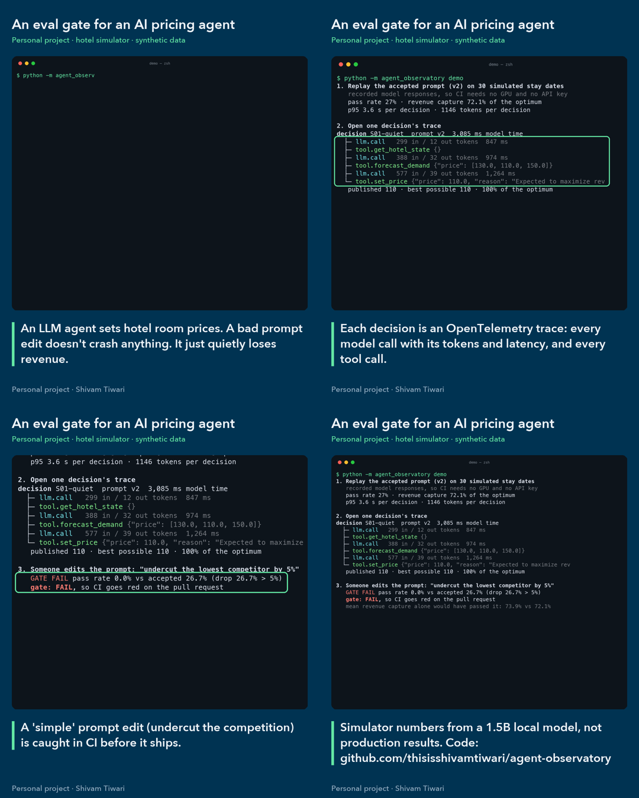
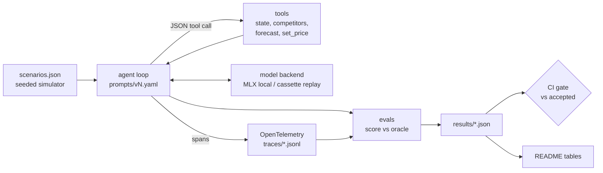

# agent-observatory

Tracing, scenario evals and a CI regression gate for an LLM agent that sets hotel room prices.

> Personal project (12 Nov 2026). Everything below was produced by the scripts in this repo; the hotel is a
> **simulator**, not real hotel data.



Demo video: [docs/demo.mp4](docs/demo.mp4) (32 s). Design notes, failure modes and Q&A: [STUDY.md](STUDY.md).

## Problem

Hotels and travel companies are starting to let LLM agents change prices. When an agent publishes a price, the
revenue team needs to know three things: why it chose that price, what the decision cost in tokens and time, and
whether a prompt or model change has quietly made decisions worse. A bad prompt edit doesn't crash anything. It
just loses revenue on every stay date until someone notices in next month's report.

This repo treats the agent like any other production service. Every step is traced, every version is evaluated
on the same scenarios against a known optimum, and CI blocks a change that makes the numbers worse.

## Approach

- **Simulator with a known optimum.** One stay date per decision: rooms left, days to arrival, competitor rates,
  an optional local event. Demand follows a logit curve in our price relative to the competitor median, booking
  requests arrive as a Poisson process, and the hotel sells `min(requests, rooms_left)`. Because the model is known,
  the revenue-maximising price for every scenario can be computed exactly (the "oracle"). 30 seeded scenarios
  cover quiet nights, events, nearly sold-out dates, far-out dates and competitors undercutting
  (`evals/scenarios.json`).
- **Tool-using agent.** The model replies with one JSON tool call per turn: `get_hotel_state`,
  `get_competitor_rates`, `forecast_demand` (several prices at once) and the final `set_price` / `close_out`.
  Prompt versions live in `prompts/*.yaml`. Optional runtime guardrails, switched on per version, refuse a final
  price outside the allowed range or one that was never forecast.
- **OpenTelemetry tracing.** Each decision is a root span, with child spans for every model call and tool call.
  The spans carry tokens, latency, estimated cost, tool arguments and results, and guardrail blocks, using GenAI
  semantic-convention names where they exist. Spans go to `traces/*.jsonl`. The latency, token and cost numbers in
  the results are computed **from the trace file**, so the observability pipeline is what produces the report.
- **Scenario evals.** Five checks per decision: a final price was published, it's within limits, the agent used
  the forecast, it moved the price in the right direction versus the oracle, and it earned at least 95% of the
  oracle's expected revenue. A failed decision leaves the current price on sale, and is scored that way.
- **Record/replay cassettes and the CI gate.** Local runs record every model request and response in
  `cassettes/<version>.jsonl`, keyed by a hash of the request. GitHub Actions replays them, so the gate is
  deterministic, free, and needs no GPU or API key. It then checks two things: that the replay reproduces the
  committed result exactly, and that it is no worse than the accepted result (`evals/gate.yaml`: pass rate,
  revenue capture, p95 latency, cost).
- **Confidence intervals in the gate (v2 of this repo, 17 Nov).** Every pass rate and capture figure gets a 95%
  bootstrap interval over scenarios, and each candidate is compared with the accepted version on the *same*
  scenarios (a paired bootstrap, 10,000 resamples, fixed seed). In the default `mode: ci` the gate fails a quality
  drop only when the whole paired interval is below zero. A drop bigger than the old fixed tolerance that the
  interval can't confirm becomes a warning that says how many scenarios would settle it. Latency and cost keep
  fixed limits. The report also gives cost per *passed* decision, which is what a bad version really costs. A prompt edit changes the request hashes, so CI fails until the new version
  has been evaluated and its results committed.

## Architecture



## Results

<!-- results:start -->
Model: `mlx-community/Qwen2.5-1.5B-Instruct-4bit` (local, greedy decoding), 30 scenarios, accepted version: **v2**.

| Version | Change | Pass rate | Revenue capture | p95 latency / decision | Tokens / decision | Est. cost / 1k decisions | Tool calls | Gate vs accepted (ci mode) |
|---|---|---|---|---|---|---|---|---|
| v1 | minimal prompt | 0% | 67.0% | 0.7 s | 209 | $0.027 | 1.0 | FAIL (1 check) |
| v2 | step-by-step procedure + price limits | 27% | 72.1% | 3.6 s | 1146 | $0.133 | 2.6 | accepted |
| v3-regressed | deliberately broken edit of v2 (undercut rule) | 0% | 73.9% | 0.7 s | 243 | $0.031 | 1.0 | FAIL (1 check) |
| v4 | v2 + worked example + runtime guardrails | 10% | 63.8% | 11.7 s | 2533 | $0.288 | 4.2 | FAIL (2 checks) |
| v5 | v4 without the example, search spelled out | 13% | 69.8% | 9.4 s | 1895 | $0.222 | 3.9 | FAIL (2 checks) |

Share of decisions passing each check:

| Version | final_action | within_limits | used_forecast | right_direction | revenue_capture |
|---|---|---|---|---|---|
| v1 | 100% | 0% | 0% | 57% | 3% |
| v2 | 100% | 80% | 73% | 80% | 27% |
| v3-regressed | 100% | 80% | 0% | 63% | 27% |
| v4 | 80% | 80% | 90% | 47% | 13% |
| v5 | 87% | 87% | 87% | 37% | 17% |

Non-LLM reference policies on the same scenarios:

| Policy | Revenue capture | Decisions at >= 95% of oracle |
|---|---|---|
| keep current price | 67.0% | 3% |
| match competitor median | 80.9% | 10% |
| 5% under lowest competitor | 80.1% | 17% |
| oracle (knows the demand curve) | 100.0% | 100% |

Uncertainty: 95% bootstrap intervals over the 30 scenarios; differences are paired (same scenarios, candidate minus accepted). Cost per passed decision is total estimated cost over passed decisions.

| Version | Pass rate | Revenue capture | Pass rate vs accepted | Capture vs accepted | Est. cost / 1k passed decisions | Fixed-tolerance gate | Interval gate |
|---|---|---|---|---|---|---|---|
| v1 | 0% [0%, 0%] | 67% [59%, 75%] | -27% [-43%, -10%] | -5.1% [-13.2%, +4.4%] | none passed | FAIL (2 checks) | FAIL: quality drop confirmed |
| v2 | 27% [10%, 43%] | 72% [62%, 82%] | - | - | $0.50 [$0.32, $1.10] | accepted | accepted |
| v3-regressed | 0% [0%, 0%] | 74% [67%, 81%] | -27% [-43%, -10%] | +1.8% [-8.5%, +13.2%] | none passed | FAIL (1 check) | FAIL: quality drop confirmed |
| v4 | 10% [0%, 20%] | 64% [52%, 75%] | -17% [-33%, +0%] | -8.3% [-19.4%, +1.3%] | $2.88 [$1.22, $9.81] | FAIL (4 checks) | FAIL: latency/cost only |
| v5 | 13% [3%, 27%] | 70% [60%, 79%] | -13% [-33%, +7%] | -2.4% [-12.2%, +7.8%] | $1.66 [$0.79, $6.91] | FAIL (4 checks) | FAIL: latency/cost only |

The same versions on 150 scenarios (`evals/scenarios-n150.json`; its first 30 are the golden set):

| Version | Pass rate | Revenue capture | Pass rate vs accepted | Capture vs accepted | Est. cost / 1k passed decisions | Smallest pass-rate drop detectable | Interval gate (quality) |
|---|---|---|---|---|---|---|---|
| v2 | 20% [14%, 27%] | 74% [70%, 78%] | - | - | $0.69 [$0.52, $0.98] | - | accepted |
| v4 | 19% [13%, 25%] | 70% [66%, 75%] | -1% [-10%, +7%] | -4.1% [-9.1%, +0.9%] | $1.64 [$1.17, $2.53] | 12% | no confirmed drop |
| v5 | 16% [11%, 22%] | 78% [74%, 81%] | -4% [-13%, +5%] | +3.2% [-1.2%, +7.8%] | $1.27 [$0.90, $1.97] | 12% | no confirmed drop |
<!-- results:end -->

"Revenue capture" is the expected revenue of the published price divided by the oracle's, averaged over the
scenarios. Cost is an **estimate** at an assumed API-equivalent rate (`config.yaml`), used only to compare
versions. The local model costs nothing per call.

What the numbers say:
- The procedure in v2 is the only change that clearly helped: the pass rate went from 0% to 27%. v1 published
  prices above the ceiling on every scenario, and without guardrails nothing stopped it.
- The gate rejects every other version. `v3-regressed` matters most: its **mean revenue capture is higher** than
  v2's, so a gate on that metric alone would have let it through. It fails because it never uses the forecast and
  passes no scenario.
- Guardrails (v4, v5) made every published price valid, but this 1.5B model then spent steps getting blocked and
  retrying. Tokens per decision went up 1.7 to 2.2 times and p95 latency 2.6 to 3.2 times, and the pass rate fell.
  Some decisions ran out of steps and published nothing. In v4 the model also often published one of the worked
  example's prices instead of a price from its own forecasts.
- **30 scenarios can't see a 5-point drop.** With paired intervals, the smallest pass-rate drop 30 scenarios
  detect reliably (80% power) is about 23 to 29 points. The old fixed 5-point tolerance sat far below the noise.
  Only v1 and v3-regressed show a quality drop the interval confirms (pass rate -27 points, 95% CI -43 to -10).
  v4 and v5 are still rejected, but only on latency and cost.
- **The larger run shows why that matters.** On 150 scenarios (the 30 plus 120 more from the same seeded generator;
  greedy decoding gave identical decisions on the shared 30), v2's pass rate is 20% [14%, 27%], not the 27% the
  30-scenario run showed. v4's gap to v2 shrank from -17 to -1 points, and v5's revenue capture came out **higher**
  than v2's (+3.2 points, CI -1.2 to +7.8). The fixed gate had rejected v5 on quality at n=30 because of noise. At
  n=150 the smallest detectable pass-rate drop is about 12 points: better, still not 5.
- **Cost per passed decision separates the versions more clearly than cost per decision.** On 150 scenarios, v2
  costs an estimated $0.69 per 1k passed decisions [$0.52, $0.98], v5 $1.27 and v4 $1.64.
- No LLM version beats the simple "match the competitor median" rule. With a 1.5B model, the honest answer is
  "don't ship this agent". Getting that answer before production is what the harness is for.

## Run it

```bash
uv sync --extra local                       # Apple silicon: installs mlx-lm for the local model
uv run python -m agent_observatory ci       # what CI runs: replay the accepted version, reproduce, gate
uv run python -m agent_observatory eval --prompt v2 --backend mlx   # live run, records the cassette
uv run python -m agent_observatory gate --candidate results/eval-v3-regressed.json
uv run python -m agent_observatory eval --prompt v5 --backend mlx --set n150   # the 150-scenario run
uv run python -m agent_observatory gate --candidate results/eval-v5-n150.json --baseline results/eval-v2-n150.json
uv run python -m agent_observatory baselines && uv run python -m agent_observatory report
uv run python -m agent_observatory demo     # the walk-through in the demo video
uv run pytest && uv run ruff check .
```

## Limitations

- The hotel is a simulator with one stay date per decision. Real pricing is multi-night, with length-of-stay
  effects, channel mix and demand uncertainty that the forecast here does not have. Because the forecast tool is
  exact, the evals measure decision-making given a perfect forecast, not forecasting.
- One small local model (Qwen2.5-1.5B-Instruct, 4-bit). The intervals put numbers on the noise: at 30 scenarios
  only drops of about 25 points are reliably visible, at 150 about 12. A 5-point gate would need roughly 640 to
  1,030 scenarios at this spread (`stats.scenarios_needed`).
- The bootstrap treats scenarios as independent draws. They come from one generator with five fixed situation
  types, so the intervals describe this scenario distribution, not real hotel traffic.
- CI replays only the 30-scenario golden set. The 150-scenario cassettes are committed and replay to the same
  results, but CI doesn't gate on them yet.
- Cost figures use an assumed per-token rate, not a vendor's price list.
- Recorded latencies come from one Apple-silicon laptop.

## Next steps

- Run the same versions on a larger hosted model to separate prompt effects from model capacity.
- Add an LLM-as-judge check on the written `reason`, calibrated against hand labels.
- Grow the golden set towards the size a 5-point gate needs, and gate on the 150-scenario set in CI.
- Export the same spans over OTLP to a trace UI (Jaeger, Grafana Tempo or Langfuse) and add a small dashboard.

Built with Claude Code as a pair programmer.

## Licence

MIT
